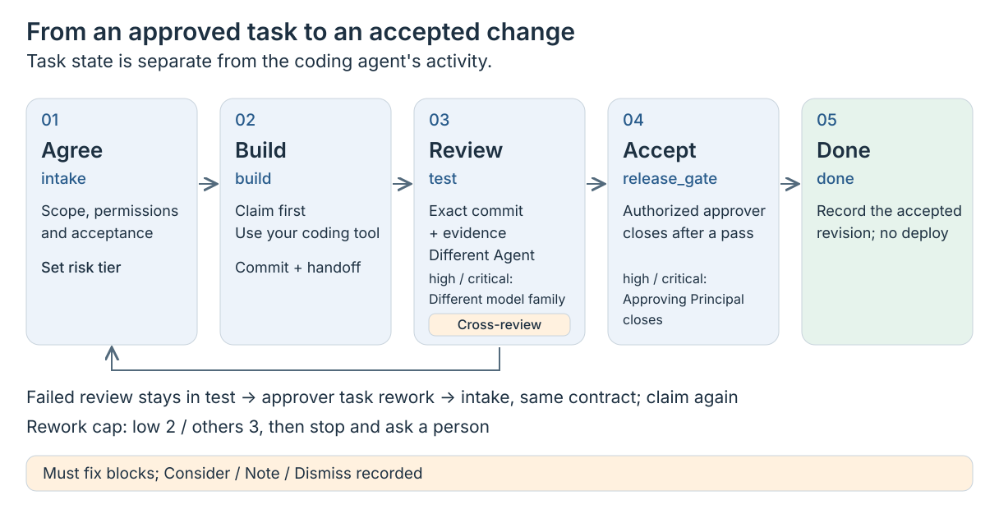

# Workkeel

コーディングエージェントのタスクを、リポジトリ内のファイルで管理する小さなフレームワーク。

承認した範囲や引き継ぎ、レビューの証跡は、Git コミットに結び付けてコードのそばに残します。
普段のコーディングツールをそのまま使えます。コアに必要なのはリポジトリ内のファイルと CLI だけです。

[English](README.md) · [繁體中文](README.zh-TW.md) · 日本語

[](https://github.com/zsz1210/workkeel/actions/workflows/ci.yml)

[npm](https://www.npmjs.com/package/@zsz1210/workkeel) 2.1.0 · Node.js 24.15+ · [MIT](LICENSE)

どの部分が安定版・ベストエフォート・実験的機能かは、[2.0 の互換性保証](docs/concepts/compatibility.md)（英語）にまとめています。

## Workkeel を使う理由

- **ツールを変えても再開できる：**会話が終わっても、別のコーディングツールに移っても、タスクの範囲、判断、途中の成果が残ります。
- **渡した変更そのものをレビューする：**別の Agent が提出コミットを確認し、その後に承認権限を持つ人が受け入れます。
- **リスクに応じてレビューする：**最初にリスク区分を合意し、ポリシーや変更内容に応じて引き上げます。やり直し回数にも上限があります。
- **コアを小さく保つ：**タスクの管理にサーバーやモデル呼び出し、グローバルなモデル設定の変更は要りません。

## 向かない用途

Workkeel はサンドボックスでもエージェントランタイムでもなく、デプロイも行いません。
普段のコーディングツールで権限を制御し、変更を実行します。Workkeel では、
タスクの権限と証跡をコミットに結び付けます。ここがタスクトラッカーとの違いです。
コーディングの実行ループは既存のツールに任せる点で、エージェントフレームワークとも異なります。

## タスクの流れ

<picture>
  <source media="(max-width: 640px)" srcset="docs/assets/workkeel-workflow-mobile.svg">
  
</picture>

範囲、権限、受け入れ条件、リスク区分を合意してからタスクを引き受け、
普段のツールで実装し、コミットを別の Agent に渡してレビューを受けます。
引き受ける前に作業をコミットしていた場合は、[タスクより前に始めた作業の引き受け方](docs/getting-started/workkeel.md#claim-work-that-started-before-the-task)（英語）を参照してください。
レビューが不合格なら、承認者が `task rework` を実行するまでタスクは `test` に留まります。
実行すると、不合格の記録を残して同じ契約のまま `intake` に戻ります。
builder が再び引き受け、新しいコミットを提出します。
やり直しは `low` が 2 回、その他は 3 回までで、上限に達したら停止して人に判断を求めます。
合格後は権限を持つ承認者が同じ候補をクローズします。`high` と `critical` では、
別のモデルファミリーによるレビューと所定の相互レビューを経て、元の承認者（Principal）がクローズします。

## 30 秒デモ

下の手順で CLI を用意したら、既存の Git プロジェクトでデモを実行します。出力には JSON の一部のフィールドだけを載せています。
`init` は 1 人の `owner` の下に `builder` と `reviewer` を登録します。モデルファミリーの既定値はそれぞれ `claude` と `codex` です。`--builder <family>` と `--reviewer <family>` で変更できます。
owner がタスクと受け入れを承認し、2 つの Agent がそれぞれ実装とレビューを行います。

```text
$ workkeel init .
{"initialized":true,"mode":"task-first"}
# .workkeel/ を Git の対象から除外し、生成した設定ファイルをコミットしてから引き受ける。
$ workkeel task new --goal "Clarify the guide" --acceptance "The guide names its audience" --write docs --risk low --actor builder
{"id":"WK-0001","state":"intake"}
$ workkeel task claim --id WK-0001 --actor builder
{"id":"WK-0001","state":"build"}
# builder がガイドを編集、確認し、変更をコミットする。
$ workkeel task handoff --id WK-0001 --actor builder --summary "Guide updated"
{"id":"WK-0001","state":"test"}
# reviewer が提出されたコミットを受け入れ条件と照らし合わせる。
$ workkeel task review --id WK-0001 --actor reviewer --judgment pass --summary "Meets the criterion"
{"id":"WK-0001","state":"release_gate"}
# owner が受け入れる。builder は、承認する Principal の下に登録された Agent。
$ workkeel task close --id WK-0001 --actor builder --summary "Owner accepts" --rollback "Revert the guide commit"
{"id":"WK-0001","state":"done","external_release":"not-performed"}
```

この `low` の例では証跡ファイルを省略できます。他の区分の要件は下の表を参照してください。
CLI はライフサイクルを記録するだけで、編集やレビューは CLI ではなく Agent が行います。
`.ai-org/` のタスク記録も、作業の変更と一緒に、またはタスクをクローズした後にコミットしてください。

## クイックスタート

Git、Node.js 24.15+、コーディングツールが必要です。npm から CLI をインストールすると、`workkeel` コマンドを使えます。

```sh
npm install -g @zsz1210/workkeel
```

`@next` はインストールしないでください。この dist-tag は古い `0.1.0-beta.1` を指したままです。

現在のソースから動かす場合は、clone します。

```sh
git clone https://github.com/zsz1210/workkeel.git
cd workkeel
npm ci --omit=optional --ignore-scripts
alias workkeel="node $PWD/bin/workkeel.mjs"
```

シェルのエイリアスは、定義した対話シェルの中でしか使えません。Agent のツール呼び出しや CI のような
非対話シェルでは、`workkeel` のエイリアスは動きません。初期化後は `node workkeelw.mjs` を、
ローカルにインストールした場合は `npx --no-install workkeel` を使ってください。

タスクを始める前に、リポジトリにはベースラインのコミットが必要です。新しいリポジトリでは、
含めるファイルを確認してから `git add -A && git commit -m baseline` を実行します。

自分のプロジェクトの Git リポジトリに移り、`workkeel start .` で書き込みを伴わないセットアップ案内を確認します。
`init` の後にもう一度 `workkeel start .` を実行すると、任意で使える[指示ファイルの連携](docs/extensions/workkeel-context.md#connect-native-instructions)の案内を確認できます。
初期化、ポリシー、証跡、ロールバックは[クイックスタートガイド](docs/getting-started/workkeel.md)を参照してください。
Workkeel 自体の開発は[貢献ガイド](CONTRIBUTING.md)に従ってください。
`node workkeelw.mjs` が CLI を探す順序は、[プロジェクトのランチャーが CLI を探す順序](docs/getting-started/workkeel.md#how-the-project-launcher-finds-the-cli)（英語）を参照してください。

## リスク区分

| 区分 | 主な用途 | クローズ前の要件 | やり直し上限 |
| --- | --- | --- | --- |
| `low` | ドキュメント、文言の変更 | 別の Agent によるレビュー。証跡ファイルは任意 | 2 |
| `standard` | 通常の機能と修正 | 引き継ぎの証跡、別の Agent によるレビュー | 3 |
| `high` | 認証、データ移行、機密データ | 別のモデルファミリー、レビュアー自身の報告書と相互レビュー。未解決事項なし。元の承認者がクローズ | 3 |
| `critical` | デプロイ、CI、本番環境の設定 | `high` の全要件に加え、引き継ぎ時のロールバック計画とコミット済みの承認記録 | 3 |

上限に達したら停止し、範囲の見直し、新しいタスクの承認、キャンセルのいずれかを人に判断してもらいます。
[QA 手順](docs/operations/workkeel-review-assessment.md#independent-qa-and-release-gate)では、
Must fix は進行を止める指摘、Consider／Note／Dismiss は記録する指摘として扱い、
`high` と `critical` には Codex／Claude による独立した相互レビューを求めます。
CLI は登録済みのモデルファミリーを検査しますが、それだけでは相互レビューの実施を証明できません。

## 1.x からのアップグレード

Workkeel 2.0.0 では、任意のコマンドを 4 つ削除しました。

| 削除するコマンド | 代わりの方法 |
| --- | --- |
| `workkeel monitor` | `workkeel status` と `workkeel task show\|summary\|metrics` |
| `workkeel workspace` | 各プロジェクトで `workkeel status` を実行 |
| `workkeel workflow` | エージェントのホストで作業し、`workkeel task claim\|handoff\|review\|close` で記録 |
| `workkeel headroom` | ツールの出力を直接読む |

削除したコマンドを実行すると、`command-removed` エラーと代わりの方法を表示し、終了コード 1 で終わります。プロジェクトのファイルは読み書きしません。既存の記録はそのまま残ります。

1.x を固定したプロジェクトでは、2.0.0 の CLI で書き込みを伴うコマンドが止まります。読み取りのコマンドは警告付きで動きます。固定バージョンを移すには、各プロジェクトで 2.0.0 の CLI を使って `workkeel upgrade --actor <id>` を実行します。実行するのは承認権を持つ Principal です。詳しくは [CHANGELOG](CHANGELOG.md#200) を参照してください。

## 任意の追加機能

- **[タスク計測とネイティブ実行レポート](docs/operations/workkeel-usage.md)：**`workkeel task metrics` で記録済みのトークンと時間を読み取ります。`workkeel usage` はホストのレポートを紐づけて収集します。
- **[Workkeel Loop L1 レポート](docs/operations/loop-trial.md)：**`workkeel stats --report --cutoff <ISO-time> --timezone <IANA-zone>` が読み取り専用の週次レポートを生成します。モデル／API の費用はかかりません。`--project` を繰り返すと、複数のプロジェクトをまとめて集計できます。0.1.0-beta.1 のタスク記録も、変更せずに読み取ります。
- **[ネイティブディスパッチ](docs/operations/workkeel-native-dispatch.md)：**実行の引き継ぎと指定モデルを記録し、何が実行されたかをホストが報告します。
- **[Bot レイヤーの参考運用](docs/operations/reference-usage-bot-layer.md)：**プロジェクト Bot、Claude Code、Codex を人の承認で連携させる一例です。コアには含まれません。

これらの機能やその他の任意機能は、[ドキュメント一覧](docs/README.md)で確認できます。

## 制限

- あらゆる中断からの復旧や、新しいマシンへのインストールは十分に検証できていません。
- Principal と Agent は記録上の名前であり、認証済みアカウントではありません。Workkeel は 2 つの Principal が別人であることや、実際に使ったモデルを証明できません。
- ローカルロックは複数マシン間の調整には使えません。ネイティブホストの使用量データは、ホストが記録した場合にだけ残ります。

## ドキュメントと貢献

[ドキュメント](docs/README.md) · [アーキテクチャ](docs/concepts/architecture.md) · [テスト](docs/getting-started/testing.md) · [貢献ガイド](CONTRIBUTING.md) · [セキュリティ](SECURITY.md) · [MIT](LICENSE) · [サードパーティの表記](THIRD_PARTY_NOTICES.md)
