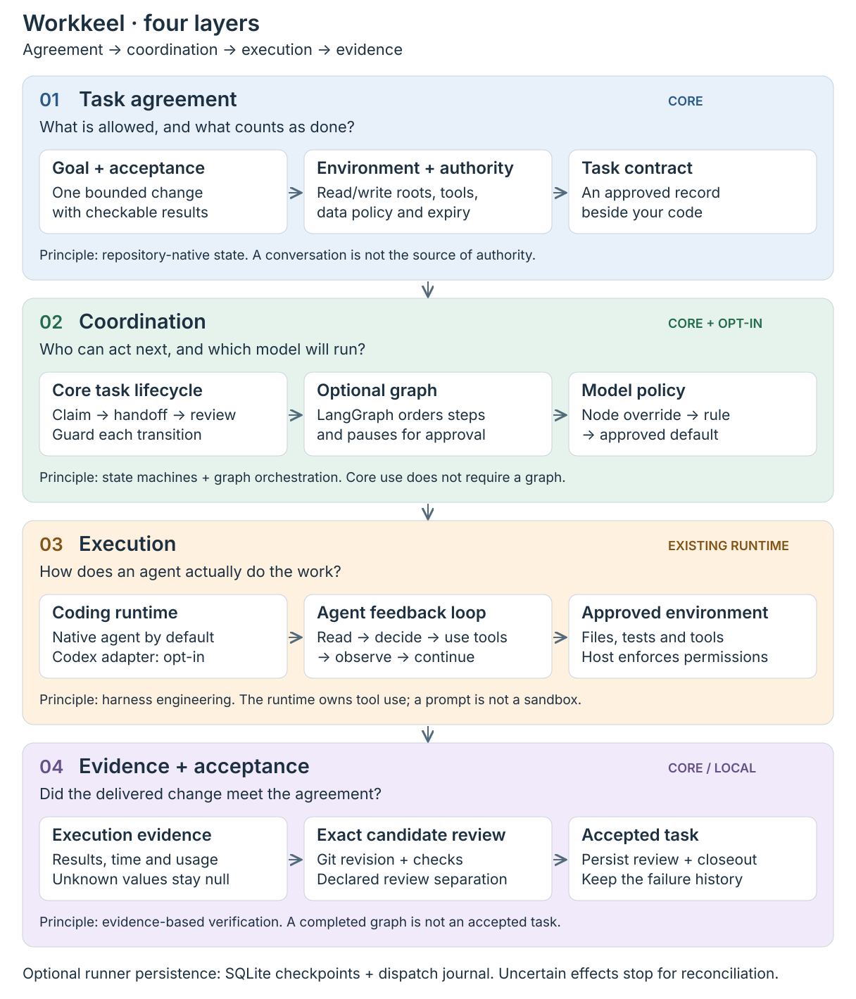

# Workkeel

コーディングエージェントのタスクと検証記録を、リポジトリで管理するフレームワークです。

承認済みの作業範囲、実行、引き継ぎ、レビューの証拠をコードと一緒に保存します。
プロジェクトの指示に従える開発ツールで、クラウドモデルにもローカルモデルにも利用できます。
OpenAI、Codex、特定のモデルを前提としません。

[English](README.md) · [繁體中文](README.zh-TW.md) · 日本語

[](https://github.com/zsz1210/workkeel/actions/workflows/ci.yml)
Beta.1 実験的プレリリース · Node.js 24+ · [MIT](LICENSE)

## できること

- **作業の再開：** ツールや会話が変わっても、目標、制約、判断、途中成果を確認できます。
- **実行の調整：** 担当、依存関係、引き渡し、再試行の上限、復旧方法を記録します。
- **ツールとモデルの選択：** ネイティブツールは既存のモデル設定を維持し、自動ワークフローでは明示的に承認されたポリシーを使います。
- **特定の版のレビュー：** 証拠と別の Agent によるレビューを Git の版に結び付け、受け入れを記録します。
- **記録の閲覧：** 任意のローカル観測サイトで、タスク、文書、学習、Skill、実行時間、トークンをモデル呼び出しなしで確認できます。

実際の操作と権限の強制は実行ツールが担当します。Workkeel の記録自体はサンドボックスではありません。
実行が終了しても、成果物が受け入れられたとは限りません。

## 依頼から受け入れまで

<picture>
  <source media="(max-width: 640px)" srcset="docs/assets/workkeel-workflow-mobile.svg">
  
</picture>

不具合修正なら、目標と変更可能なファイルを承認してから、開発ツールで調査と実装を行います。
テストの証拠を保存し、別の Agent に候補版をレビューしてもらいます。
複数工程を同じモデルに任せることも、異なるモデルに分けることもできます。記録はプロジェクトに残ります。

[クイックスタート](docs/getting-started/workkeel.md) ·
[ワークフロー実行](docs/operations/workkeel-workflows.md)

## Beta.1 をインストールする

Node.js 24+ と既存の開発ツールが必要です。プロジェクトのディレクトリで実行します。

```sh
npm install --save-dev --save-exact --ignore-scripts @zsz1210/workkeel@0.1.0-beta.1
npx --no-install workkeel --version
npx --no-install workkeel start .
```

Beta.1 は早期評価向けに npm の `next` チャネルで公開されています。検証結果と制約は
[リリースノート](CHANGELOG.md#010-beta1)と[テスト方針](docs/getting-started/testing.md)を参照してください。
インストールだけでは初期化や移行は行いません。`start` は設定案内を表示するだけです。
続きは[クイックスタート](docs/getting-started/workkeel.md)に従ってください。

## ソースから始める

ソース開発には Git と Node.js 24+ が必要です。main ブランチには固定された Beta.1 パッケージの公開後の変更が含まれる場合があります。

```sh
git clone https://github.com/zsz1210/workkeel.git
cd workkeel
npm ci --omit=optional --ignore-scripts
node bin/workkeel.mjs help
node bin/workkeel.mjs start /path/to/project
```

最後のコマンドは、セットアップの案内と未完成のポリシー／タスク草案を表示するだけです。
モデルは起動しません。[クイックスタート](docs/getting-started/workkeel.md)に従い、初期化、
タスクの承認、担当の登録、レビューを進めてください。

Task-first プロジェクトでは WORKKEEL.md と workkeel CLI を使います。任意の
[AGENTS／CLAUDE ブリッジ](docs/extensions/workkeel-context.md)は既存の指示を保持します。
workkeel-init／workkeel-work はネイティブの初期設定と引き渡し用です。フレームワーク開発の
5段階フローは[別の非公開ワークスペース](docs/operations/framework-development.md)で実行します。
この公開 repo はフレームワークのコード、公開文書、汎用テンプレート、再現可能なテストのみを保持します。
実際のタスク、承認、実験、ログ、レビューの証拠は、Git が無視するファイルも含めて外部に置きます。
TEMPLE.md と temple-work は既存プロジェクトの旧版互換モードに属します。

## ローカル観測サイト

```sh
npx --no-install workkeel monitor /path/to/task-first-project
```

ソースから実行する場合は `node bin/workkeel.mjs monitor` を使用します。
端末に表示される完全なローカルアクセス URL を開くと、次の情報を確認できます。

- Dashboard、Task board、Activity、Backlog の文書テーブル。
- 実行時間／トークンの棒グラフ、タスク散布図、日次／週次推移と共通フィルター。
- プロジェクト Skill の出所と全文検索、学習記録と段階表示。
- 読み取り専用の設定、タスク詳細、図解付きの仕組みの説明。
- 繁体字中国語と英語。Settings で切り替えられます。

**観測サイトはモデルを呼び出しません。** ローカルプログラムが既存の記録を読み取り、
集計します。グラフ、検索、更新によるモデルのトークン消費はありません。
タスクを実行するツールの消費とは別です。欠損値と部分的な値を明示し、料金は推定しません。
ページ表示中に更新し、非表示時は停止します。Ctrl-C で前景サービスを終了できます。
常駐プロセスや外部グラフサービスは導入しません。

[観測サイトの使い方とデータの制約](docs/operations/workkeel-observer.md)

レビュー済みソースには、登録した複数のプロジェクトとリポジトリを確認し、
タスクの詳細と許可されたポリシー設定を扱う
[デスクトップワークスペース](docs/operations/workkeel-workspace.md)もあります。
タスクの権限は各プロジェクトに残ります。追加機能にはソース CLI を使用します。
ソースの更新は npm の新しい公開を意味しません。
[範囲を定めた目標の継続](docs/operations/workkeel-autonomy.md)と
[バージョン別のプロジェクト Skill 学習](docs/extensions/workkeel-skill-lifecycle.md)も提供します。
実行終了、独立レビュー、タスク受入れは別々に記録します。

## 既定値、オプション、対応範囲

### 経験の再利用

ネイティブな[学習記録](docs/extensions/workkeel-learning.md)は、出所、検証、後続タスクでの利用をつなぎます。
`workkeel learning search` は明示した多言語キーワードから現在有効な指針を探し、
`learning impact` は出所の変更が影響する Lesson、Practice、Skill を調べます。
発見、閲覧、適用、結果の検証は別々に記録し、観測サイトは読み取りのみを行います。
提案条件を満たしても Skill は自動作成されず、時間やトークンの節約が証明されたことにもなりません。

| 機能 | 既定 | 現在の範囲 |
| --- | --- | --- |
| タスク調整 | コア | 契約、担当、引き渡し、レビュー、受け入れ。サーバー不要 |
| 開発ツールとモデル | 既存ホスト | 指示に従えるホスト。ローカルモデルを使うホストも含む。全体のモデル設定は変更しない |
| 自動ワークフロー | 任意 | 任意の LangGraph 依存と承認済みグラフ。自動実行には実際の adapter が必要 |
| モデルルーティング | 任意 | 明示指定 → 承認ルール → 承認済み既定値。分類モデルは呼び出さない |
| 組み込み自動 adapter | 任意／実験段階 | Codex app-server。サブスクリプション構成には macOS と Codex ≥ 0.155.0-alpha.9.2 が必要 |
| Gateway 接続 | 任意 | 対応実行ホスト経由で、承認済みの固定 OpenAI-compatible／LiteLLM 接続を利用。実機検証は別途 |
| Headroom | 無効 | ホスト統合による可逆的な出力ビュー。すべてのツール出力を自動取得するものではない |
| 観測サイト | 任意 | ローカル、読み取り専用、モデル呼び出しなし。記録済み task-first データを表示 |
| 学習と Skill | 任意の記録 | Lesson、Practice、範囲を定めた作成提案。承認だけでは Skill を作成・有効化しない |

自動実行の依存関係と実装済み adapter は[実行ガイド](docs/operations/workkeel-workflows.md)に記載しています。
ネイティブな連携に使えるツールでも、組み込み自動 adapter や使用量の自動収集があるとは限りません。
フレームワーク共通のモデルやプロバイダーは指定していません。

## アーキテクチャ

<picture>
  <source media="(max-width: 640px)" srcset="docs/assets/workkeel-architecture-mobile.svg">
  
</picture>

プロジェクトのファイルが権限と証拠を保持し、任意の実行器がグラフの進行と承認済みモデル選択を管理します。
開発ホストは強制された権限の範囲で作業します。チェックポイントとディスパッチ記録が復旧を支え、
副作用が不明な場合は再実行前に照合します。観測サイトは記録を読むだけで、作業を実行しません。

[アーキテクチャ](docs/concepts/architecture.md) ·
[実行計測](docs/operations/workkeel-measurements.md) ·
[範囲を限定した再開](docs/operations/workkeel-material-and-continuation.md) ·
[Skill の選択と証拠](docs/extensions/workkeel-context.md)

## 検証と制約

実験段階の Beta です。中断／拒否後の完全な復旧と新規環境への導入は未検証です。ローカルロックは分散調整ではなく、記録上の身元はプロバイダー認証ではありません。
ネイティブセッションの使用量は、ホストが記録しなければ自動取得されません。
Skill の指定は適切な適用の証明ではなく、学習の段階表示も自動昇格を意味しません。

プロバイダー実験が確認するのは記録された条件だけです。過去の Codex 互換性や Luna／Sol の結果は例であり、
他のモデル、ツール、サブスクリプションの節約や将来の版についての証明ではありません。
実際の実験記録は非公開の開発ワークスペースに保存します。
[計測の定義と制約](docs/operations/workkeel-measurements.md) ·
[再現可能なチェック](docs/getting-started/testing.md)

[ドキュメント](docs/README.md) · [テスト](docs/getting-started/testing.md) ·
[貢献](CONTRIBUTING.md) · [セキュリティ](SECURITY.md) ·
[互換性と移行](docs/getting-started/workkeel.md#legacy-history-and-migration)

[MIT](LICENSE) · [第三者通知](THIRD_PARTY_NOTICES.md)
