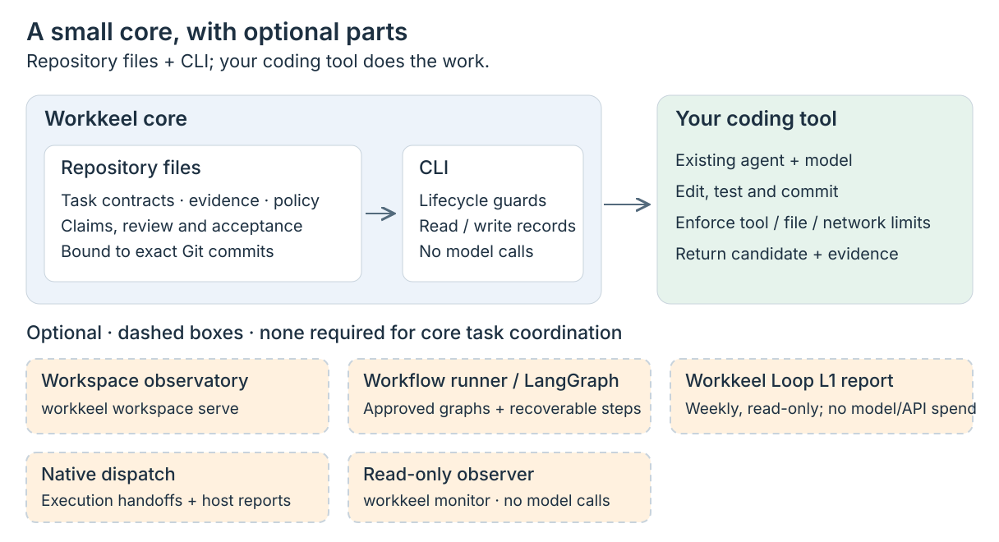
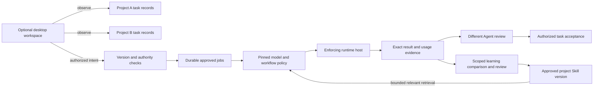

# Architecture

## Core and optional parts

Use repository files to store task contracts, evidence and policy, and the CLI
to record claims, handoffs, review and acceptance. These make up the core.
Your existing coding tool executes the work and enforces its permissions.
You need no server, workflow runner or model call for core task coordination.

The dashed boxes show optional additions. Start the workspace observatory with
`workkeel workspace serve`, or use `workkeel monitor` for the separate read-only
observer. For opt-in workflows, use a LangGraph runner and approved model policy.
Use native dispatch to record execution handoffs. For a weekly read-only view
with no model/API spend, use the
[Workkeel Loop L1 report](../operations/loop-trial.md) through
`workkeel stats --report --cutoff 2026-10-19T00:00:00Z --timezone UTC`.

## Workkeel execution and authority boundaries

Native Workkeel coordinates approved tasks in the repository. A
`workkeel.lock` pins the CLI and explicit Agent/Principal approval policy. Each
`.ai-org/work-items/` record keeps an immutable contract, current claim, exact
candidate, evidence digests, review, closeout and failed-attempt history.

Framework development uses native Workkeel in a
[separate private workspace](../operations/framework-development.md). Contributors
follow this source checkout's [AGENTS.md](../../AGENTS.md) and the private
workspace's generated `WORKKEEL.md`. Actual maintainer task state and evidence
must remain outside the public checkout, including Git-ignored files.
Use the [native quickstart](../getting-started/workkeel.md) for new projects and
the [daily-work guide](../operations/workkeel-daily-work.md) for task operations.

The host coding agent executes the work and enforces actual tool, filesystem,
network and data controls. Optional project Skills supply specific procedures;
they are not authority or a mandatory generic model-capability catalog. Model
transport is separate. Native coordination uses the existing coding agent; opt-in
workflows use LangGraph to orchestrate a registered runtime, not replace the
runtime's internal coding loop. The concrete Codex host uses the existing ChatGPT
subscription and explicitly selected models. See the
[workflow guide](../operations/workkeel-workflows.md) and
[execution ADR](../adr/0073-opt-in-workflow-execution.md).

The optional native [desktop workspace](../operations/workkeel-workspace.md)
observatory starts only with `workkeel workspace serve`; core task and goal
delivery does not depend on it. It observes registered projects without relocating
their task authority. Its controlled settings feed exact approved pins into new
dispatches. A bounded continuation
runner resumes eligible approved work; improvement discovery creates evidenced
proposals rather than new permission. Versioned Skill reuse stays project-local.

These are source capabilities. The workspace makes no idle inference calls,
dispatch completion does not accept a task, and a Skill cannot grant authority.
See [ADR-0085](../adr/0085-native-workspace-bounded-autonomy-and-skill-learning.md).

| Boundary | Authoritative source | Enforcement |
| --- | --- | --- |
| Task approval and acceptance | Immutable task contract; canonical task operations | Claim, scope, dependency, evidence and distinct-review guards |
| Workflow progress | Pinned workflow/policy; local SQLite checkpoints and intent/result journal | One run per claim, bounded dispatch, integrity checks and explicit uncertain-state reconciliation |
| Model selection | Approved node/rule/default policy; runtime catalog | Connection pinning, reported-model continuity and refusal of silent rerouting |
| Files, tools and networking | Actual qualified coding host | Codex permission profiles and disabled unsupported tools; unsupported constraints stop launch |
| Project context | Native instructions and selected Skill sources | Bounded selection, full reading and separate output review; prompts are not a sandbox |

Recovery state is local and excluded from Git. It can include task outputs; retain
it securely. A completed runtime operation is not a task review. A digest detects
changed records, not malicious host behavior or authenticated human intent.
Checkpoints do not establish exactly-once effects across external services.
